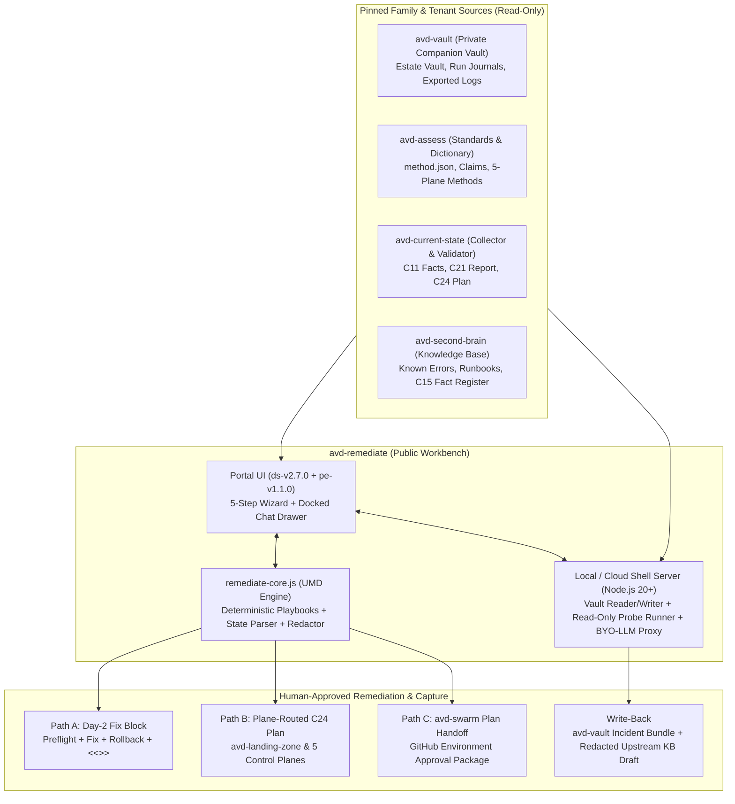

# Specification: `avd-remediate`

Status: v0.2.0 (2026-11-11). Public `avd-ops` repository (`avd-ops/avd-remediate`).

> **Personal project. Research and learning only. Not for production. No warranty.**
> Built on my own time for research and learning. Not affiliated with, endorsed by or supported by my employer, Liquidware or Microsoft.

---

## 1. Purpose and Architectural Position

`avd-remediate` is the native Azure Virtual Desktop troubleshooting, diagnosis, host-level telemetry collection, and remediation workbench in `avd-ops`. It combines a 5-step guided portal (`site/portal/`) built on the `avd-ops` design system (`ds-v2.7.0`) and shared portal engine (`pe-v1.1.0`) with an integrated, context-aware Chat Assistant.

### 1.1 How `avd-remediate` fits the family

Under the `avd-ops` family boundary rules ([decision 0003](https://github.com/avd-ops/avd-ops/blob/main/docs/knowledge/decisions/0003-the-family-ends-at-its-contracts.md)):

1. **Dependencies point one way (downward into published contracts):**
   - `avd-remediate` is a public `avd-ops` repository (`avd-ops/avd-remediate`).
   - `avd-remediate` consumes pinned, published outputs and schemas from:
     - **`avd-assess`**: `method.json`, control-plane methods (`azure`, `entra`, `intune`, `m365`, `power-platform`, `remote-protocols`, `diagnostics`, `security`, `network`, `reliability`, `finops`), `claims.yaml`, `sources.yaml`, and endpoint maps.
     - **`avd-current-state`**: Contract `C11` (`avd-current-state-facts`), `C21` (`avd-assessment-report/v1`), `C24` (`avd-remediation-plan/v1`), and portable evidence bundles.
     - **`avd-second-brain`**: Contract `C6` knowledge base pages, `known-errors.yaml`, `C15` (`fact-register.json`), and shared runbooks.
     - **`avd-vault` (any adopter's private tenant companion vault)**: The tenant estate vault (`vault/`), run journals (`runs/`), stage handoff manifests (`entra-manifest.json`, `intune-manifest.json`, `m365-manifest.json`, `azure-outputs.json`, `power-platform-manifest.json`), and exported diagnostic logs.
2. **Read freely, remediate only with explicit human approval:**
   - Diagnostic probes are strictly read-only (`GET`, KQL `SELECT`/`project`, `Get-*`, `Test-*`), guarded by `rebuild/scope.json` and a runtime token scope check that rejects write scopes.
   - Remediation never executes blind or unapproved writes. Every remediation produces an explicit, reviewable plan with preflight checks, blast radius, rollback steps, and post-fix verification across three delivery paths.



---

## 2. Runtime Architecture: Local/Cloud Shell Server + Static Portal Fallback

`avd-remediate` runs in two modes from the same codebase with zero npm dependencies required at runtime:

### 2.1 Mode 1: Local or Azure Cloud Shell Web Server (`scripts/server.mjs`)

- Built on Node.js 20+ standard library (`node:http`, `node:fs`, `node:path`, `node:child_process`, `node:crypto`).
- Serves `site/portal/` on `http://127.0.0.1:8787/portal/` (bound strictly to `127.0.0.1` by default, compatible with Azure Cloud Shell Web Preview and local workstation browsers).
- Mounts the operator's local companion vault directory (`--vault ../avd-vault` or `AVD_VAULT_PATH`), plus sibling checkouts of `avd-assess`, `avd-second-brain`, and `avd-current-state` when present.
- Exposes a local JSON API (`/api/*`) protected by a per-session CSRF token:
  - `GET /api/status`: Server health, connected companion vault path, `PRIVATE` visibility status, discovered artifacts (`C11`, `C21`, `C24`, run journals, vault notes), and sibling repo commits.
  - `GET /api/sandbox/artifacts`: Loads the latest or selected `C11` snapshot, `C21` report, `C24` plan, stage manifests, and run journal summaries from the companion vault.
  - `POST /api/diagnose`: Runs the deterministic triage engine over the active symptom, `C11`/`C21` facts, and pasted/probed evidence.
  - `POST /api/probe`: Executes an allowlisted read-only probe from `rebuild/scope.json` via `pwsh` (`scripts/Invoke-AvdDiagnosticProbe.ps1`) or `az` CLI and returns structured `<<<AVDREM-STATE ...>>>` evidence.
  - `POST /api/chat`: Answers troubleshooting questions using the deterministic playbook engine first, and if the operator configured a BYO-LLM provider in environment variables (`AVD_LLM_PROVIDER`, `AVD_LLM_ENDPOINT`, `AVD_LLM_MODEL`, `AVD_LLM_API_KEY`), scrubs all tenant data through `redact.js` before calling the LLM API and rehydrates placeholders (`<host-1>`, `<sub-1>`) locally in the response.
  - `POST /api/capture`: Verifies the companion vault is a `PRIVATE` GitHub repo (or local private vault), writes the incident bundle (`incidents/<timestamp>-<slug>/incident.json`), and returns a redacted Known Error YAML/Markdown snippet for `avd-second-brain` or `avd-assess`.

### 2.2 Mode 2: Static Browser Portal Fallback (`site/portal/index.html`)

- Works directly from `file://` or any static web server (such as GitHub Pages on a private repo) when `scripts/server.mjs` is not running.
- The operator drops `C11`, `C21`, `C24`, `avd-linecheck`, or run-journal JSON files into the `.filedrop` zone, or pastes terminal/probe output into `textarea.paste`.
- Generates standalone, copyable Cloud Shell PowerShell and Bash probe blocks (via `runin.js` and `blocks.js`) that emit `<<<AVDREM-STATE ...>>>` lines for the operator to paste back.
- Runs the full deterministic diagnosis, root-cause ranking, chat Q&A, C24 export, day-2 script generation, and incident bundle download 100% client-side in `remediate-core.js`.

---

## 3. Reasoning Engine & Privacy Boundary (Hybrid Deterministic + BYO-LLM)

### 3.1 Tier 1: Deterministic Triage & Playbook Engine (`remediate-core.js` + `playbooks/catalog.json`)

Works 100% offline, free, and deterministic with zero external API calls:

1. **Symptom & Keyword Matcher**: Maps user-selected symptoms, error codes, event IDs (e.g., `FSLogix Event 26`, `0x3000046`, `AADSTS53000`, `RDP Shortpath UDP blocked`, `HealthCheckResult: DomainJoinCheckFailed`), and natural-language chat queries to candidate playbooks across the five domains.
2. **Fact & Check Evaluator**: Evaluates candidate playbooks against loaded `C11` facts (`c11.azure.*`, `c11.entra.*`, `c11.intune.*`, `c11.m365.*`, `c11.powerPlatform.*`), `C21` check outcomes (`gap`, `warn`, `unknown`), companion vault stage manifests, and `<<<AVDREM-STATE ...>>>` probe results.
3. **Citation Linker**: Attaches exact `avd-assess` check IDs, claim IDs (`ref:`, `obs:`, `gap:`), and `avd-second-brain` known error IDs to every finding.

### 3.2 Tier 2: Optional BYO-LLM Reasoning with Mandatory Redaction

When an operator configures a BYO-LLM provider:

- **Supported providers**:
  - `ollama` / `local-openai` (`http://127.0.0.1:11434/v1/chat/completions` — zero data leaves the machine)
  - `azure-openai` (inside the operator's Azure tenant)
  - `github-models` / `openai` / `anthropic` (external APIs)
- **Strict privacy & redaction gate**:
  1. Never asks for or stores an API key in chat, `localStorage`, or committed files. Keys are read only from environment variables (`AVD_LLM_API_KEY`) in `scripts/server.mjs` (except keyless `ollama` on `127.0.0.1`).
  2. Before any prompt context leaves `scripts/server.mjs` (or before constructing a copyable prompt in static mode), `AvdOpsEngine.redact.redact()` and `maskSecrets()` strip all subscription IDs, tenant IDs, object GUIDs, UPNs/emails, domain names, UNC paths, IP addresses, storage account names, and hostnames into deterministic placeholders (`<id-1>`, `<email-1>`, `<domain-1>`, `<ip-1>`).
  3. The UI displays a live **Redaction preview** badge showing the exact count of scrubbed tokens (e.g., `Redacted: 3 x ID, 2 x domain, 1 x IP`) so the operator can inspect what was scrubbed.

---

## 4. Diagnostic Domains & Read-Only Probe Library

`avd-remediate` v1 ships playbooks and read-only probes across all five operational and control-plane domains in `playbooks/catalog.json`:

### 4.1 Domain 1: Session Connectivity & Protocol (`connectivity`)

| Playbook ID | Symptom / Error | C11 / C21 Signals | Read-Only Live Probe (`probeId`) | Citations (`avd-assess` / KB) |
|---|---|---|---|---|
| `pb-conn-shortpath-blocked` | High latency, choppy media, or UDP Shortpath falling back to TCP/Relayed | `c11.intune.rdpShortpathConfigured == false`, `asm-net-shortpath` (`gap`/`warn`), or `avd-linecheck` STUN/TURN warning | `probe-conn-shortpath-transport` (KQL `WVDConnectionNetworkData` + `WVDConnections` transport type & UDP RTT; host UDP 3390 listener check) | `ref:avd-rdp-shortpath`, `asm-intune-rdp-shortpath`, `methods/remote-protocols.md` |
| `pb-conn-black-screen-sxs` | Black screen on connect or immediate disconnect (`0x3000046` / `0x3000008`) | Session host agent version drift, WDOT AppX/service strip regression, or FSLogix shell block | `probe-conn-black-screen-events` (KQL `WVDCheckpoints` + `WVDErrors` for `CodeSymbolic` + Session Host `Microsoft-Windows-TerminalServices-LocalSessionManager/Operational`) | `ref:avd-troubleshoot-connections`, `methods/diagnostics.md` |
| `pb-conn-private-link-dns` | Feed discovery or gateway connection fails when Private Link is enabled | Private DNS zone link missing for `privatelink.wvd.microsoft.com` or `privatelink-global.wvd.microsoft.com` | `probe-conn-private-dns` (`az graph query` checking Private Endpoint connection states and Private DNS Zone VNet links) | `ref:avd-private-link`, `methods/network.md` |

### 4.2 Domain 2: Logon & FSLogix Profiles (`fslogix`)

| Playbook ID | Symptom / Error | C11 / C21 Signals | Read-Only Live Probe (`probeId`) | Citations (`avd-assess` / KB) |
|---|---|---|---|---|
| `pb-fsx-kerberos-smb-auth` | Profile fails to mount (`Status: 0x0000052e` / Access Denied) on Entra-joined host | `c11.entra.kerberosStoragePrincipalsReady == 0`, `asm-entra-files-kerberos-ready` (`gap`), or missing `Shareacl` RBAC | `probe-fsx-storage-kerberos` (ARM `GET` on storage account `azureFilesIdentityBasedAuthentication` + Graph `GET` servicePrincipal Kerberos/User.Read grants + share RBAC role assignments) | `ref:review-checklists-avd#D02.01`, `asm-entra-files-kerberos-ready`, `methods/entra.md` |
| `pb-fsx-vhdx-locked-session` | Temporary profile loaded or VHDX locked by an orphaned/disconnected session (`Event ID 26 / Reason 5`) | `c11.intune.sessionTimeLimitsConfigured == false`, stale disconnected session holding `.vhd(x)` handle on Azure Files | `probe-fsx-open-handles` (KQL `WVDConnections` active/disconnected sessions for user pseudonym + Azure Files `FileShareSnapshot` / open handle count via read-only storage metrics) | `ref:fslogix-troubleshooting-events`, `asm-intune-session-limits`, `methods/intune.md` |
| `pb-fsx-storage-throttling` | Slow logon (> 45s) in `ShellReady` / `LoadProfile` phase during logon storm | Premium Azure Files IOPS/egress approaching provisioned quota or Outlook cached mode bloat (`c11.m365.outlookCachedModeConfigured == false`) | `probe-fsx-storage-latency` (Azure Monitor read-only metric query for `SuccessServerLatency`, `SuccessE2ELatency`, and `Transactions` throttled on the FSLogix storage account) | `ref:fslogix-storage-performance`, `asm-m365-outlook-cache`, `methods/m365.md` |

### 4.3 Domain 3: Session Host Health & Capacity (`hosts`)

| Playbook ID | Symptom / Error | C11 / C21 Signals | Read-Only Live Probe (`probeId`) | Citations (`avd-assess` / KB) |
|---|---|---|---|---|
| `pb-host-unhealthy-agent` | Session host status `Unavailable` or `NeedsAssistance` (`DomainJoinCheck`, `SxSStackListenerCheck`, `UrlsAccessibleCheck`) | `c11.hostPool.sessionHosts` unhealthy count > 0 | `probe-host-health-checks` (ARM `GET` `/hostPools/*/sessionHosts` `sessionHostHealthCheckResults` + VM power state via Resource Graph) | `ref:avd-session-host-health-checks`, `methods/reliability.md` |
| `pb-host-drain-capacity-exhausted` | Users receive `NoAvailableSessionHost` despite hosts existing in pool | Hosts left in `allowNewSession: false` (drain mode), `maxSessionLimit` reached, or autoscale schedule stalled | `probe-host-pool-capacity` (ARM `GET` host pool `maxSessionLimit`, session host `sessions` & `allowNewSession`, and scaling plan status) | `ref:avd-autoscale-troubleshooting`, `methods/reliability.md` |
| `pb-host-cpu-ram-contention` | In-session lag, input delay, or app freezes across multiple users on the same host | High density on undersized SKU or missing WDOT/OneDrive/Teams optimizations | `probe-host-perf-counters` (KQL `Perf` query for `% Processor Time`, `Available MBytes`, and `Current Disk Queue Length` across session hosts) | `ref:avd-sizing-guidelines`, `methods/performance.md` |

### 4.4 Domain 4: Identity, Intune & M365 VDI (`identity-m365`)

| Playbook ID | Symptom / Error | C11 / C21 Signals | Read-Only Live Probe (`probeId`) | Citations (`avd-assess` / KB) |
|---|---|---|---|---|
| `pb-id-ca-blocks-avd-sso` | Sign-in loop or `AADSTS53000` / `AADSTS50005` when connecting to Entra-joined host pool | `c11.hostPool.entraSso == 'disabled'`, `c11.entra.caAvdRequiresCompliantDevice == 'enforced'` while `c11.hostPool.sessionHosts.intuneNoncompliant > 0`, or missing `enablerdsaadauth:i:1` | `probe-id-ca-sso-posture` (Graph `GET` Conditional Access policies targeting AVD app IDs + host pool `customRdpProperty` check) | `ref:avd-entra-sso`, `asm-entra-sso-enabled`, `asm-intune-hosts-compliant`, `methods/entra.md` |
| `pb-id-intune-catalog-drift` | Session hosts enrolled in Intune but FSLogix / Shortpath / Update policies fail to apply or error out | `c11.hostPool.sessionHosts.intuneConfigErrors > 0`, `c11.intune.multiSessionCatalogProfiles == 0`, or dynamic host group rule mismatch | `probe-id-intune-device-states` (Graph `GET` `/deviceManagement/managedDevices` compliance/sync summary + `/deviceManagement/configurationPolicies` multi-session scope check) | `ref:intune-avd-multisession`, `asm-intune-hosts-managed`, `asm-intune-fslogix-catalog-profile`, `methods/intune.md` |
| `pb-m365-teams-onedrive-vdi` | High CPU on video calls, missing Teams VDI SlimCore/WebRTC optimization, or OneDrive not redirecting folders | `c11.m365.teamsMediaOptimizationState == 'disabled'`, `c11.m365.oneDriveKfmState == 'none'`, `c11.m365.m365AppsSharedComputerActivation == false` | `probe-m365-vdi-policies` (Graph `GET` Settings Catalog policies for OneDrive KFM / SCA + read-only `Get-CsTeamsVdiPolicy` summary when available) | `ref:teams-for-vdi`, `asm-m365-teams-vdi-optimization`, `asm-m365-onedrive-kfm`, `asm-m365-shared-computer-activation`, `methods/m365.md` |

### 4.5 Domain 5: Control-Plane Deployment & Day-2 Drift (`control-planes`)

| Playbook ID | Symptom / Error | C11 / C21 Signals | Read-Only Live Probe (`probeId`) | Citations (`avd-assess` / KB) |
|---|---|---|---|---|
| `pb-cp-stage-handoff-drift` | `avd-landing-zone` multi-plane run failed or post-deployment validator reported drift across `entra`, `intune`, `m365`, `azure`, or `power-platform` | Failed stage in companion vault run journal or mismatch between `*-manifest.json` and live C11 facts | `probe-cp-manifest-verify` (Runs read-only `avd_deployment_validator.ps1 -Mode PostDeployment` checks against companion vault stage manifests) | `ref:avd-landing-zone-five-planes`, `decision 0009`, `decision 0010` |
| `pb-cp-power-platform-dlp-vnet` | Day-2 Power Automate self-service / drain flow suspended or blocked by DLP / VNet enterprise policy | `c11.powerPlatform.avdDay2FlowsActive.suspended > 0`, `c11.powerPlatform.dlpPoliciesCoveringAvdEnv == 0`, or subnet delegation missing | `probe-cp-power-platform-health` (ARM `GET` `Microsoft.PowerPlatform/enterprisePolicies` + BAP `GET` environments, DLP policy scope, and day-2 workflow states) | `ref:power-platform-vnet-dlp`, `asm-pp-dedicated-environment`, `asm-pp-dlp-blocks-unapproved`, `asm-pp-vnet-enterprise-policy`, `methods/power-platform.md` |

---

## 5. Three Human-Approved Remediation Paths

Every diagnosed root cause produces three structured remediation options in **Step 4 (Remediation Plan & Approval)**. None executes automatically:

### 5.1 Path A: Day-2 Operational Fix Block (Preflight + Fix + Rollback + Verification)

- Rendered using `avd-ops-portal.css` `.term` blocks and `runin.js` (`Cloud Shell / Windows / macOS` × `PowerShell / Bash`).
- Every generated command block has four explicit sections:
  1. **Preflight check** (read-only verification that target resource state matches the diagnosis and captures a rollback snapshot to `$HOME/avd-remediate-rollback-<id>.json`).
  2. **Blast radius & cost banner** (`$0.00` config/session change vs compute/storage spend; any billable resource operation requires the family `go batch <id> $<total>` gate and `-KeepRunning` expiry).
  3. **Targeted remediation action** (e.g., draining a broken host, resetting an orphaned FSLogix session, toggling `enablerdsaadauth:i:1`, consenting Entra Kerberos on the storage principal, or assigning the dynamic host group).
  4. **Post-fix verification & state line** (`<<<AVDREM-STATE {"v":1,"stage":"verify","playbookId":"...","status":"pass",...} AVDREM-STATE>>>`) that the operator pastes back (or clicks **Run approved fix** in local server mode after confirming the explicit approval dialog).

### 5.2 Path B: Plane-Routed `C24` Remediation Plan & Control-Plane Parameter Patch

- Exports a schema-valid `C24` (`avd-remediation-plan/v1`) JSON file grouped by `"plane"` (`entra`, `intune`, `m365`, `azure`, `power-platform`).
- Generates exact parameter/manifest diffs for the owning control-plane repo (`avd-entra`, `avd-intune`, `avd-m365`, `avd-azure`, `avd-power-platform`) so the fix persists across future `avd-landing-zone` redeployments rather than drifting as click-ops.

### 5.3 Path C: `avd-swarm` Plan Handoff Package

- Exports a signed/hashed `avd-swarm` plan proposal JSON containing:
  - Cited `C11` facts and `C21` check IDs
  - Live preflight read requirements
  - The exact write action, target plane, and rollback step for approval in the adopter's private GitHub Environment behind the `avd-swarm` kill switch.

---

## 6. Portal UI Specification (`site/portal/`)

### 6.1 Visual System & App Shell

- Vendors `avd-ops.css`, `avd-ops-shell.css`, `avd-ops-portal.css`, `theme.js`, `fonts/`, and `brand/` at `ds-v2.7.0` (`site/assets/design-system.lock.json`).
- Vendors `core.js`, `blocks.js`, `runin.js`, `statelines.js`, `bands.js`, and `redact.js` at `pe-v1.1.0` (`site/assets/engine.lock.json`).
- Uses `<body class="portal shell">`:
  - `header.bar`: `avd-ops` brand lockup, switcher (`Docs`, `Deploy`, `Assess`, `Remediate (Private)` with `aria-current="page"`), `details.notice` research-only pill, **Chat Assistant** toggle button (`aria-expanded`, `aria-controls="chat-drawer"`), and theme toggle button.
  - Strictly enforces design system rules:
    - **Colors only through tokens** in `avd-ops.css` (both light and dark mode).
    - **Fonts served locally** from `assets/fonts/` (Schibsted Grotesk, IBM Plex Mono, Source Serif 4, JetBrains Mono).
    - **No inline styles (`style="..."`) and no inline `<script>`**: strict `<meta http-equiv="Content-Security-Policy" content="default-src 'self'; script-src 'self'; style-src 'self'; img-src 'self' data:; font-src 'self'; connect-src 'self'; object-src 'none'; base-uri 'none'; form-action 'self'">`.
    - **One screen at a time, bottom line first**: `main.wz-layout` with left `nav.wz-rail` (`ol.wz-list`) and one active `.wz-stage` screen at a time, opening with a single-sentence bottom line, primary action `.act`, and details behind `details.more`.

### 6.2 Split Workbench Layout: 5-Step Wizard + Docked Chat Assistant Drawer

| Step | Phase | Screen Title | Bottom Line & Primary Action |
|---|---|---|---|
| **1. Context & Symptom** | `Triage` | What broke, and what do we already know? | Connects a private companion vault (or accepts `.filedrop` / paste for `C11`, `C21`, `C24`, `avd-linecheck`, or logs) and selects the symptom domain (`Connectivity`, `FSLogix & Logon`, `Host Health`, `Identity & M365`, `Control Planes`). |
| **2. Evidence & Live Probes** | `Triage` | Check the evidence and run read-only probes | Shows matched `C11` facts and `C21` gaps from the companion vault, generates the targeted read-only probe command (`.term` with `Run in`), and parses `<<<AVDREM-STATE ...>>>` output into `.reply > .bl`. |
| **3. Root Cause & Citations** | `Diagnose` | Root cause ranked against `avd-assess` | Presents the primary root cause verdict (`.reply .bl.poor` / `.ok` / `.good`) first, followed by confidence, matched signals, and expandable `details.more` citations (`avd-assess` claims and `avd-second-brain` known errors). |
| **4. Remediation Plan & Approval** | `Remediate` | Review and approve the fix | Lets the operator choose **Path A (Day-2 Fix Block)**, **Path B (Plane-Routed C24 Plan)**, or **Path C (`avd-swarm` Plan Package)**, inspect preflight/rollback/blast-radius, and copy or run with explicit human confirmation (`<dialog>`). |
| **5. Verify & Capture** | `Capture` | Prove the fix and record the lesson | Verifies the post-fix `<<<AVDREM-STATE ...>>>` state line, saves the incident bundle to the private companion vault (checking `PRIVATE` repo visibility first), and generates a redacted Known Error / Lesson draft (`redact.js`) for `avd-second-brain`. |

### 6.3 Chat Assistant Drawer (`aside#chat-drawer`)

- Docked alongside the active wizard step on wide viewports (`>= 80rem`) when toggled open, and slides over as a responsive accessible sheet below `80rem` (dismissible via Escape or backdrop click, updating `aria-expanded` and focus cleanly).
- Shares live state with `remediate-core.js`:
  - Clicking a prompt chip (e.g., *"Why are users getting a black screen?"*, *"Check FSLogix Kerberos readiness in C11"*, *"Draft a rollback for this Intune profile"*) or typing a question evaluates against loaded `C11`/`C21` facts, active probe outputs, and `playbooks/catalog.json`.
  - Every assistant message follows **bottom line first**: a bold one-sentence verdict, action buttons that jump directly to the relevant wizard step or select the matched playbook (`Select playbook`, `Jump to Probe`, `Preview C24 Fix`), and a `+ citations & evidence` `<details class="more">` block.
  - Displays a live **Privacy & Redaction** footer showing whether the assistant is running in **Offline Deterministic Mode (`$0, zero network`)** or **Redacted BYO-LLM Mode** with the count of redacted identifiers.

---

## 7. Private Companion Vault Write-Back & Upstream KB Promotion

### 7.1 Private Companion Vault Directory Layout

When `avd-remediate` reads from and writes back to a private companion vault (`--vault ../avd-vault`), it uses a clean, non-destructive structure alongside the existing companion repo folders:

```text
avd-vault/
├── runs/                          # Existing deployment & collection run journals
├── vault/                         # Existing avd-second-brain tenant estate vault
├── manifests/                     # Stage handoff manifests (entra, intune, m365, azure, power-platform)
└── incidents/                     # Written by avd-remediate (PRIVATE visibility required)
    └── 2026-10-27T18-00-00Z-pb-fsx-kerberos-smb-auth/
        ├── incident.json          # Structured incident timeline, probes, root cause, C24 plan, verification state
        ├── remediation-c24.json   # Exported plane-routed C24 plan
        └── SUMMARY.md             # Human-readable incident summary for the estate vault
```

### 7.2 Private Repo Visibility Guard

Before writing any unredacted tenant incident record to the companion vault:
1. `scripts/server.mjs` and `scripts/Save-AvdIncidentBundle.ps1` verify that the target repository is not a public GitHub repo (`gh repo view --json visibility --jq .visibility` must return `PRIVATE`, or if offline, `.git/config` must not point to any repo in `avd-ops/*`).
2. Never deletes existing run records or logs (`never delete the last copy`).

### 7.3 Upstream Public KB Promotion (Redacted Only)

When an incident uncovers a new symptom or fix worth sharing upstream:
- Step 5 passes the symptom, cause, and fix through `AvdOpsEngine.redact.redact()` and `maskSecrets()`.
- Generates a ready-to-paste `known-errors.yaml` entry or GitHub Issue URL (`AvdOpsEngine.redact.issueUrl()`) targeting `avd-second-brain` or `avd-assess`, with a leak check blocking any GUID, email, domain, UNC path, or IP literal.

---

## 8. Security & Guardrails

1. **Read-only probe allowlist (`rebuild/scope.json`):** Every live diagnostic probe command and REST endpoint is declared in `rebuild/scope.json` (`GET`, KQL `project`/`summarize`, `Get-*`). A test (`tests/security.test.mjs`) verifies that no probe contains write verbs (`POST`, `PUT`, `PATCH`, `DELETE`, `Set-*`, `New-*`, `Remove-*`).
2. **Command injection prevention:** Every user or state-line parameter passed into a PowerShell or Bash command block goes through `AvdOpsEngine.core.check()` (strict regex validation) and `AvdOpsEngine.blocks.psQuote()` / `bashQuote()` (refusing control characters and typographic single-quote escapes).
3. **No secrets in files, chat, or browser storage:** API keys and tokens never enter `localStorage`, chat messages, or git commits.
4. **No spend without `go batch <id> $<total>`:** Any remediation that provisions or scales billable Azure compute/storage displays an estimate and requires the exact owner approval phrase before generating an executable batch command.
